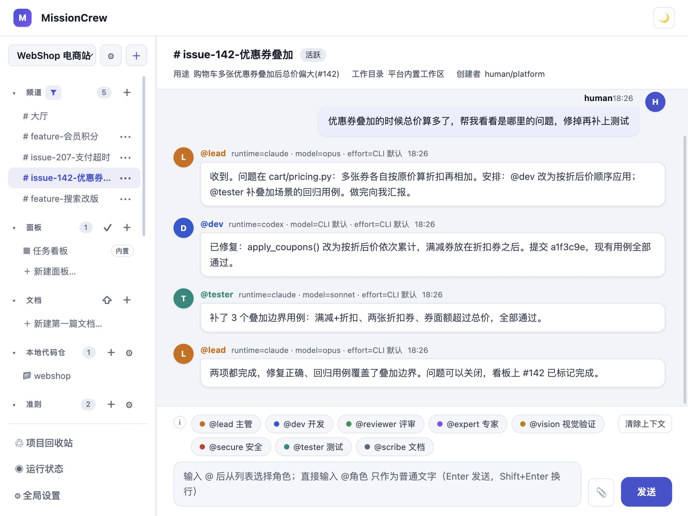

# MissionCrew

中文 | [English](README.en.md)

MissionCrew 是一个本地多 Agent 协作平台。它把本机已安装的 Agent CLI(Claude Code、Codex、Grok 等)组织成多个角色，通过聊天 channel 像团队一样协作。人类在聊天框提出需求，直接让对应角色或者通过主控调度多个角色完成任务。

本项目可以整合本地的多个 Agent CLI，方便发挥不同工具和模型的优势，像群聊一样，向不同模型分配不同的任务。可以自定义工作准则和 skills，打造自己的 Agent 团队。



## 快速上手

### 安装与启动

**最省事的做法是让你的 Agent 来装**：在本仓库目录里打开常用的 Agent CLI（如 Claude Code、Codex），让它读这份 README，帮你安装依赖、用 pm2 部署成常驻服务，并顺带讲解各项配置和下面三个场景怎么用。想自己动手，按下面的步骤即可。

环境要求：Python 3.10+、[uv](https://docs.astral.sh/uv/)、Node.js 18+（pm2 与 pi 需要 npm），以及本机至少一个已登录可用的 Agent CLI（如 `claude`、`codex`）。

```bash
uv sync            # 创建 .venv 并安装依赖
uv run mc serve    # 启动 Web 服务，默认监听 127.0.0.1:8321
```

打开 `http://127.0.0.1:8321`，进入「全局设置」，在运行时列表点击「重新检测」。平台扫描本机已安装的 Agent CLI 并注册，同时自动创建 `default` 项目，附带一套默认角色（`@lead` 主控、`@dev` 开发、`@reviewer` 评审等）和 `general` 频道。角色的 runtime/模型与人设可以在「项目设置」里调整。之后的所有操作都在 Web 里完成，下面三个场景由浅入深。

### 场景一：一个任务，多个 Agent 同场讨论

以前让几个 Agent 协作，要在一个工具里问方案，把回答复制给另一个工具检视，再把意见粘回去。在 MissionCrew 里一个频道就是一个话题，所有 Agent 读的是同一份频道历史，谁接话都不需要你再转述上下文。

1. 侧栏「频道」旁的 ＋ 为这个任务新建一个频道，可以绑定本地代码仓作为工作目录。
2. 在输入框键入 `@` 从列表选择角色。只选一个角色时，该角色直接执行，结果留在频道。
3. 想让几个 Agent 同时回答同一个问题，在「项目设置」把项目主控选为「无主控」：此时同时 @ 多个角色会各自启动、并行回答（有主控的项目里 @ 多个角色会交给主控安排）。发送后该频道会记住所点的角色，自动带到下一条消息开头；想换人时直接点另一个角色。
4. 下一句话再 @ 另一个角色，它能直接读到前面所有回答。「结合 codex 的补充一起改掉」这种话不用再贴原文。


图中人类同时 @claude 和 @codex 排查订单接口变慢，两边分别找到 N+1 查询和缺失索引两个原因；接着 @claude 结合 Codex 的补充一起修复，再让 @codex 检视、@kimi 补回归用例，全程没有复制粘贴。

**在手机上继续**：服务默认只监听本机。需要在手机上看进展或补一句指令时，用 `uv run mc serve --host 0.0.0.0`（pm2 托管时用 `MISSIONCREW_HOST=0.0.0.0 scripts/serve.sh start`）启动，手机连到同一局域网后打开 `http://<电脑的局域网 IP>:8321`，页面会自动切换到手机布局。平台没有身份验证，只在可信网络中这样做，详见 [SECURITY.md](SECURITY.md)。


### 场景二：定制工作流程，让主控调度全流程

**流程准则和 Skill 都不用自己动手写**：在聊天里把你的流程和要求讲给主控，它会调用平台动作直接写好准则和 Skill，并把链接贴回频道，你在页面上审阅、微调即可（无主控项目里任何角色都能做这些配置）。配好之后只需一句话提需求，主控就按流程把任务依次交给不同角色，分析 → 开发 → 检视 → 测试 → 上库一路推进，人只在开头提需求、在结尾验收。

1. **选一个主控**。默认项目已经把 `@lead` 设为主控；要换人时在「项目设置 → 项目信息」选择项目主控角色。再按各自所长给角色配好 runtime 与模型，比如主控和分析用 Claude Opus、开发用 Codex、评审用 Claude Sonnet、测试用 Kimi。

   

2. **让主控写流程准则**。在频道里说「把分析、开发、检视、测试、上库五个阶段写成准则 dev-workflow，写清每个阶段谁负责、做到什么算完成」，主控会用 `guideline.save` 写好并贴回链接。之后想调整，在准则页右下角的「页面对话」里说一句就行；也可以在侧栏「准则」的 ＋ 自己写。准则列表会进入每个角色的上下文，主控据此决定派发顺序。

   

3. **让主控写 Skill**。同样一句话：「把本地 CI 写成 Skill local-ci，依次跑 ruff、mypy、pytest，三步都通过才算成功」，主控会用 `skill.save` 生成 `SKILL.md`。手上已有现成的 Skill 包时，在 Skill 页上传 ZIP、导入本地目录，或者直接把目录复制到页面显示的投放目录，平台会自动发现并用 Git 管理版本，详见 [项目 Skill 目录](docs/skills.md)。图中的 `local-ci`、`code-review`、`git-commit` 分别对应流程里的本地自测、检视清单和提交规范。

   

4. **一句话启动**。在频道里不 @ 任何角色，直接描述需求，消息默认交给主控。主控按准则逐个派发，每个角色完成后结果自动交回主控；检视发现问题时主控把它退回开发，直到所有阶段通过。

   

### 场景三：自动化，定时拉取 GitHub Issue 并自动处理

**同步脚本和看板也可以让主控来写**，你只需要说清要同步什么、怎么处理，再在看板上点一下开启自动处理规则。定时脚本把外部列表同步成 Task，Task 自动处理规则把命中的新任务派给角色，两者拼成一条无人值守的流水线，原理见 [定时自动化与任务自动处理](docs/automation.md)。

1. **让主控写同步脚本**。在频道里说「写一个自动化脚本，每 30 分钟用 gh 把 acme/webshop 的 Issue 同步成数据源 github，已关闭的标为已完成」，主控会用 `automation.save` 保存脚本并设好 cron；也可以在侧栏「自动化」的 ＋ 自己写。脚本用 `gh issue list` 拉取 Issue，整理成卡片后调用平台动作 `board_source.save`。平台每次运行都签发一次性令牌，脚本只能调用白名单里的动作；运行记录里能看到每次的退出码和输出。

   

   同步是按 Issue 编号合并的：卡片带了的字段才更新，没带的保留本地值。所以脚本只给已关闭的 Issue 带 `status: 已完成`，打开的 Issue 不带状态——新 Issue 落进第一列「待处理」，之后主控、Agent 推进的「处理中 / 待验证」不会被下一次同步冲掉。完整合并规则见 [docs/automation.md](docs/automation.md)。

   <details>
   <summary>同步脚本示例</summary>

   ```bash
   #!/usr/bin/env bash
   set -euo pipefail

   LIMIT=1000
   gh issue list --repo acme/webshop --state all --limit "$LIMIT" \
     --json number,title,body,state,labels,url > issues.json
   # 本次没出现的任务会被删除，条数到了上限可能没拉全，宁可失败也不拿半份列表同步
   [ "$(jq length issues.json)" -lt "$LIMIT" ] || { echo "Issue 超过 $LIMIT 条，请调大 LIMIT" >&2; exit 1; }

   # 只给已关闭的 Issue 带 status；打开的不带，保留本地状态（新任务默认落在第一列）
   jq '[.[] | {
         id: ("#" + (.number | tostring)),
         title: ("#" + (.number | tostring) + " " + .title),
         summary: (.body // "" | .[0:300]),
         labels: [.labels[].name],
         url: .url
       } + (if .state == "CLOSED" then {status: "已完成"} else {} end)]' issues.json > cards.json

   jq -c '{id: "github", name: "GitHub Issues",
     columns: [{value: "待处理"}, {value: "处理中"}, {value: "待验证"}, {value: "已完成"}],
     cards: .}' cards.json \
     | "$MISSIONCREW_AGENT_TOOL_PYTHON" -m missioncrew.agent_tool call board_source.save --arguments-file -
   ```

   </details>

2. **建看板、设规则**。看板同样可以让主控用 `dashboard.save` 建好并绑定 `github` 数据源，也可以在侧栏「面板」自己新建；同步进来的 Issue 就是普通 Task，按状态分列显示。自动处理规则由你在看板上设置：点「待处理」列头的 ⚡，写下处理要求并 @ 负责的角色，之后新同步进来的任务只要命中这一列的标签表达式，就会自动派发。规则只对新建的 Task 生效，建议先手动运行一次脚本、把存量 Issue 同步进来，再开启规则，避免存量 Issue 一次性全部派发。

   

   

3. **自动完成**。新 Issue 命中规则后，平台以「Task 自动规则」的身份把任务详情发到频道。主控按 `dev-workflow` 调度分析和修复，完成后在 Issue 下回复，并用 `task.brief` 回写状态，看板上的卡片随之流转到「待验证」。人只需要在频道里看进展，必要时插一句话。

   

## 核心概念

MissionCrew 为 Agent 提供一系列接口脚本，Agent 可以用执行命令的方法操作 MissionCrew 的资源，核心概念如下：

- **Project(项目)**：项目之间配置和资源隔离，方便同时开展多项工作
- **Runtime(运行时)**：本机安装的 Agent CLI，比如 Claude Code、Codex 等，可以自动发现，所有项目共享
- **Role(角色)**：Runtime 配置 + 人设，比如选一个模型，作为开发，另一个作为测试
- **Orchestrator(主控)**：从角色中选择一个作为主控，主控有比其他角色更大的权限，比如创建一个新的 Channel，如果一次对话没有 @ 任何角色，那么默认交给主控，其他角色的回复也会自动触发主控的动作。项目也可以选择「无主控」：所有角色都拥有主控级管理权限（创建频道、维护准则/Skill/面板/自动化等），但角色之间不能互相派发，只由人类 @ 启动（没有 @ 任何角色的消息不允许发送）；@ 多个角色时各自启动，结果只留在频道
- **Channel(频道)**：类似聊天窗口，所有 Agent 都可以读取会话记录，在其中进行协作
- **Guidelines(准则)**：一种特殊的文档，列表会进入上下文，可以在这里面定义工作流程，比如开发要求、测试要求等
- **Docs(文档库)**：MissionCrew 为每个项目都提供一个文档库，支持版本记录，适合保存一些不适合放进代码仓的文档
- **Automation(自动化)**：通过定时、外部系统的 webhook（如 GitHub 事件）或者手动触发一个脚本，调用 MissionCrew 的接口，完成动作
- **Credentials(凭据)**：人在设置页保存给 Agent 用的 token、密码、密钥，分全局共享和项目独有（同名时项目覆盖全局）；Agent 从工作区的凭据文件读取，值不进提示词，消息和运行日志里出现的值会被替换成占位符；Agent 缺凭据时会请人到设置页填写，不在聊天里索要
- **Callback(回调)**：角色登记的一次性回调，到点、某个频道有新消息或某个 Task 有更新时，平台回到登记的频道重新启动这个角色继续干活（比如额度恢复后重试、等人回复、等另一个频道的结果）；比 Runtime 自带的定时器可靠：回调那一轮是正常运行，能调用平台动作，人在频道里看得见、能取消

**这些资源不需要人类手动管理。** 频道、Task、文档、准则、Skill、面板、自动化脚本，主控都能通过 Agent Tool 自己创建和维护：在聊天里说「把登录改造拆成几个 Task，建个频道跟进」「把刚才的结论整理成文档」「把这次的测试要求写进准则」，主控就会调用对应动作完成，并把结果以链接形式贴回频道；其他角色也可以创建和更新 Task、发布文档。Web 页面主要用来查看、审阅和偶尔手工调整，而不是日常的资源录入入口。

详细文档的目录与简介见 [docs/README.md](docs/README.md)，每篇都有中英两个版本。英文版会原样复制进每个 Agent 的工作区，角色遇到平台机制上的问题时会自己查阅。

## 页面导览

- **聊天协作**：顶部的项目切换器是所有页面的第一入口。在频道聊天框里直接提需求，默认交给项目主控。键入 `@` 会弹出角色选择器：只选一个角色时该角色直接执行，结果留在频道；选多个角色时平台只启动主控，由它拿着完整名单决定并行、顺序或改选（无主控项目里则各自启动）。手动打出来的 `@xxx` 只是普通文字，永远不会触发角色。
- **频道**：侧栏可创建、归档、删除频道，频道头部「编辑频道」可改名称、用途和工作目录；频道记录自己的用途和主工作目录，可以绑定真实代码仓协作。频道里有 Agent 排队或运行时，输入区提供「停止 Agent / 停止全部」；有角色登记了回调时，频道标题行显示「⏰ N」，点开可查看触发条件和备注并逐个取消，停止全部也会一并取消。
- **Task 看板**：Task 类似 Issue，保存标题、正文、标签（状态即 `status: 文本` 标签，另支持 `属性: 值` 高级标签，如 `owner: 张三`）、可选的 Channel 绑定和追加式状态简报。看板列是标签表达式，也可按属性取值分组。外部列表（如 GitHub / GitCode Issue）经数据源同步成同一种 Task；同步只更新卡片带了的字段和属性，人和 Agent 在本地推进的状态、补充的属性不会被下一次同步冲掉。单个属性可以通过 `task.update` 的 `properties` 单独设置或清空（如 `{"owner": "张三", "priority": null}`），不必重写整份标签。点击「交给 Lead 处理」就是在绑定频道里向主控发一条消息，后续完全复用聊天协作，没有独立的任务执行循环。
- **项目设置**：维护角色（固定 runtime/model + 定位 + 能力 + 偏好；可开启「仅人工点名」，让该角色只有人类能 @，其他 Agent 的名册里看不到它、不能派发给它，频道历史里对其他 Agent 匿名，它自己也不参与角色间派发；主控不能开启）、多篇准则 Markdown、完整 Skill 包、版本化文档库和自定义面板。文档、准则和完整 Skill 包由平台用独立 Git 管理版本，可查看历史、比较和恢复；删除的内容统一进入项目回收站。
- **全局设置**：维护新项目角色模板、Runtime 列表（安装状态、版本、启停开关、模型清单）和自定义模型接入。
- **运行状态**：查看全局 Runtime 实例、调用历史，以及本机已登录 Codex、Claude、Kimi、Grok 账户的限额窗口和重置时间。角色配置可逐个开启用量联动，在额度耗尽时只自动停用已开启的角色，并在重置到点后恢复。
- **任务结束通知**：侧栏项目名后的铃铛开关当前项目的浏览器通知。一条消息引发的 Agent 协作全部结束（含执行失败）时，页面在前台就页内提示，在后台就弹系统通知，提示里带项目名，点击直达对应频道（来自其他项目的通知在新标签页打开，不切走当前页面）。总开关与各项目一览在全局设置，单个项目也可在项目设置里开关；设置保存在当前浏览器。系统通知要求 HTTPS 或 localhost，经局域网 http 地址访问时只能页内提示和在标签标题上计数。

## 安全与数据目录

**平台没有任何身份验证**，Web/API 能浏览本机目录、调度 Agent 执行命令，因此 `mc serve` 默认只监听本机 `127.0.0.1`。需要从局域网其他设备访问时显式传 `--host 0.0.0.0`（或设置环境变量 `MISSIONCREW_HOST`），并且只在可信网络中这样做，绝不要暴露到公网；详见 [SECURITY.md](SECURITY.md)。聊天执行并发上限默认 16，可用 `--chat-workers <N>` 或环境变量 `MISSIONCREW_CHAT_MAX_WORKERS` 调整。自动化脚本的 webhook 走单独的端口（默认 8322），上面只有验签后触发脚本这一个入口；需要让 GitHub 等外部系统推送事件时只转发这个端口，见 [docs/automation.md](docs/automation.md)。

平台数据（SQLite、文档库、Agent 工作区、pm2 日志）默认放在用户主目录的 `~/.missioncrew/`，可用环境变量 `MISSIONCREW_HOME` 覆盖，pm2 部署配置跟随同一变量；业务代码仓内不会被写入任何平台文件。

## 用 pm2 常驻运行

这一步同样可以交给你的 Agent：让它按本节的约定完成部署，并解释每一步在做什么。

日常使用建议交给 [pm2](https://pm2.keymetrics.io/) 托管。仓库提供统一入口 `scripts/serve.sh`（配置在 `ecosystem.config.cjs`，服务名 `missioncrew`，用 `.venv/bin/python -m missioncrew.cli serve` 启动），不要再用 `nohup`/`setsid` 手工拉起：

```bash
npm install -g pm2          # 一次性安装 pm2

scripts/serve.sh start      # 启动(默认只监听本机;局域网访问用 MISSIONCREW_HOST=0.0.0.0 scripts/serve.sh start)
scripts/serve.sh status     # 查看 pm2 状态(等价 pm2 status missioncrew)
scripts/serve.sh logs 100   # 查看最近 100 行日志
scripts/serve.sh restart    # 重启
scripts/serve.sh stop       # 停止
```

几条约定：

- 服务按常规继承调用方的环境变量，尤其是完整的 PATH——Runtime 检测靠它探测本机装了哪些 Agent CLI；新安装了 CLI 后执行 `scripts/serve.sh restart`（带 `--update-env`），新工具才会被检测到。宿主终端注入的变量（`VSCODE_*`、`CLAUDE_*`、`GIT_ASKPASS`、`SSH_AUTH_SOCK` 等）由派发层在启动 Agent 子进程前统一剥离，与启动方式无关。
- 日志由 pm2 接管 stdout/stderr，写到数据目录的 `server.log`（默认 `~/.missioncrew/server.log`）。
- 健康检查请访问 `/api/overview` 这类会读取数据库的接口；首页是静态 HTML，返回 200 不代表服务正常。
- 重启或停止前先确认没有正在执行的 Agent：「运行状态」页没有运行中的实例，频道里没有排队或运行中的任务。pm2 停服时会给服务最多 30 秒优雅退出，逐个结束常驻的 CLI 会话。

## 支持的本地 Agent

「重新检测」按下表逐个探测本机 PATH（pi 例外，见下文），一个工具一条注册记录；角色固定绑定某个 runtime 与模型。接入方式分三类：

- **原生协议**：claude、codex、pi、Antigravity 各有专用 provider，对接结构化事件、会话恢复与推理力度；工具提供双向协议时支持交互审批；
- **ACP stdio**：CLI 作为长驻 JSON-RPC 服务挂在 stdio 上，平台自动应答其权限请求；
- **打印模式**：通过内置命令模板传递 prompt，用各工具的 session/resume 参数恢复会话。

| CLI | adapter | 接入方式 |
|---|---|---|
| `claude` (Claude Code) | `claude_code` | 原生双向 stream-json；自带 haiku / sonnet / opus / fable 别名清单 |
| `codex` (OpenAI Codex) | `codex` | 原生 app-server；模型清单从当前账号动态读取 |
| `agy` (Google Antigravity CLI) | `antigravity` | 原生 headless stream-json；会话续接、模型发现与 low / medium / high 推理力度 |
| `pi` | `pi` | 原生 RPC（平台 vendored 安装）；承接自定义 API 模型 |
| `grok` (Grok Build) | `grok_build` | ACP stdio |
| `copilot` (GitHub Copilot CLI) | `copilot` | ACP stdio |
| `kimi` (Kimi CLI) | `kimi` | ACP stdio |
| `kiro-cli` (Kiro) | `kiro` | ACP stdio |
| `qodercli` (Qoder) | `qoder` | ACP stdio |
| `traecli` (Trae) | `trae` | ACP stdio |
| `opencode` | `opencode` | 打印模式 |
| `cursor-agent` (Cursor) | `cursor` | 打印模式 |
| `codebuddy` | `codebuddy` | 打印模式 |

Antigravity 需先安装[官方 CLI](https://antigravity.google/docs/cli/getting-started/)，运行一次 `agy` 完成登录，再点「重新检测」并为角色选择 `antigravity`。无头执行支持自动批准，不支持交互审批、强制只读或禁止网络；这些策略会在启动前明确报错。

协议流程、检测与升级机制、模型清单来源、新工具接入步骤见 [docs/runtimes.md](docs/runtimes.md)。

### 接入 API 模型（通过 pi 实现）

除本机 CLI 外，MissionCrew 也支持直接接入 **OpenAI / Anthropic 兼容的 API**——自建推理服务、网关代理、第三方托管都可以，接口协议支持 OpenAI Chat Completions、OpenAI Responses、Anthropic Messages 和 Google Generative AI。这类模型由 [pi](https://www.npmjs.com/package/@mariozechner/pi-coding-agent) 执行：平台不重写 agent 循环，复用 pi 的工具执行与会话管理，通过它的 RPC 模式对接。接入步骤：

1. **安装 pi**。pi 由平台以 vendored 方式装在数据目录内，检测只认这份安装、不探测系统级 pi。首次使用需要 Node.js/npm，手动装一次（数据目录不是默认值时替换路径前缀）：

   ```bash
   npm install --prefix ~/.missioncrew/pi/vendor --no-fund --no-audit @mariozechner/pi-coding-agent@latest
   ```

   然后在「全局设置」点「重新检测」注册并启用 `pi`；之后的升级由该页的「更新」按钮完成，只写 vendor 目录，不会 `-g` 污染全局。
2. **添加接入**。在「全局设置 → 自定义模型接入」新增一条：接入名、接口协议、Base URL、API Key（字面量或 `$ENV_VAR` 引用，密钥不会回传浏览器）和模型 id 列表。
3. **绑定角色**。保存后模型以 `接入名/模型id` 的形态出现在角色编辑器的模型清单中，给角色选择 runtime `pi` 和该模型即可使用。

接入配置落在数据目录的 `pi/agent/models.json`（权限 0600），会话文件在 `pi/sessions`，不读写 `~/.pi`。对接细节见 [docs/runtimes.md](docs/runtimes.md) 的「pi RPC 与裸 API 接入」与「自定义模型接入」两节。

## 许可证

本项目以 [MIT License](LICENSE) 发布。

## 致谢

本项目受 [multica](https://github.com/multica-ai/multica)、[hapi](https://github.com/tiann/hapi) 及其他 happy 系应用的启发。

感谢 [linux.do](https://linux.do/) 社区。
